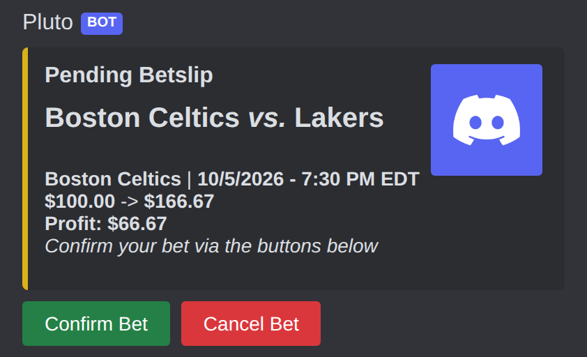

# Components V2 in Pluto

Pluto is moving its Discord messages from classic embeds to Discord **Components V2**. A V2 message has no `content` and no `embeds`. It is a tree of components: a container with an accent colour, text blocks, separators, sections, media galleries and button rows. This guide says which components Pluto uses, how to lay out a screen, how to route its buttons, and where Discord's limits bite. Every rule links to the code that enforces it.

The last section tracks the migration: each classic message, its "before" screenshot, and its status.

## Start from the kit

Build every V2 message with `v2Payload()` in `src/lib/discord/v2/kit.ts`. It returns `{ components: [container], flags, allowedMentions, files? }` and handles four things you would otherwise forget:

- It sets `MessageFlags.IsComponentsV2`, plus `MessageFlags.Ephemeral` when you pass `ephemeral: true`.
- It sets `allowedMentions: { parse: [] }`, so `<@id>` renders as a name and never pings.
- It admits button rows first, then fills the rest of the 40-component budget with blocks. Blocks that do not fit are dropped.
- It caps text across all blocks at 4000 characters. A `text()` or `footer()` block that runs past the remaining budget is shortened and ends with `…`. Any other block that does not fit, such as a `section()`, is dropped along with every block after it.

`v2Payload()` never throws on overflow. Tests use the strict checks instead (see [Test every builder](#test-every-builder)).

| Helper | Discord component | Use it for |
| --- | --- | --- |
| `text(content)` | Text Display | Headings (`##`, `###`), body text, lists. Clamps to 4000 characters before discord.js can throw. |
| `footer(content)` | Text Display with `-#` | Small grey subtext at the end. It replaces the embed footer. |
| `divider(spacing?)` | Separator | A line between groups. Spacing defaults to small. |
| `section(lines, accessory)` | Section | One to three text lines with a thumbnail or a button on the right. Extra lines are dropped. |
| `thumbnail(url)` | Thumbnail | A section accessory. |
| `gallery(urls)` | Media Gallery | Full-width images, such as the profile card. |
| `accent(name)` | Container accent colour | Converts a hex string from `src/lib/colorsConfig.ts` (`success`, `error`, `warning`, `info`, `PlutoYellow`) to the number Discord needs. |
| `v2EditFlags()` | Flags for edits | `editReply` after a defer. It sets only `IsComponentsV2`, so for a private `followUp` use `v2Payload({ ephemeral: true })` instead. |

The other kit files cover the cases a plain send does not:

- `edit.ts` has `isV2Message()`, `editMessageToV2()` and `editInteractionToV2()`. They convert a classic message, including one posted before a deploy, into V2 through the REST API. Discord allows that switch only when `content`, `embeds`, `poll` and stickers are cleared explicitly, which `message.edit()` does not do.
- `notice.ts` has `sendErrorNotice()`, which shows an error without breaking a V2 screen.
- `paginator.ts` has `renderPage()`, the `pg.v1.*` button codec and a page-source registry. `src/interaction-handlers/v2-pagination-handler.ts` routes its buttons. No command registers a page source yet, so it is ready for the first list screen that migrates.

## Know which screens are V2 today

| Screen | Builder | Sent by | Visibility |
| --- | --- | --- | --- |
| `/profile` card and Share button | `profileCardPayload()` in `src/lib/discord/builders/profile.ts` | `src/commands/account/profile.ts` | Ephemeral |
| Shared profile card | `profileSharedPayload()` in the same file | `src/interaction-handlers/profile-share-handler.ts` | Public |
| `/props enable`, `disable`, `status` | `src/lib/discord/builders/props-settings.ts` | `src/commands/configuration/props.ts` | Ephemeral |
| Period winners post | `periodWinnersPayload()` in `src/lib/discord/builders/period-winners.ts` | `src/utils/cron/PeriodWinnersCronService.ts` | Public, in a channel |
| `/parlay` builder | `ParlayBuilderService.render()` in `src/services/ParlayBuilderService.ts` | `src/commands/betting/parlay.ts` and the parlay handlers | Ephemeral |
| Error notices on V2 screens | `sendErrorNotice()` in `src/lib/discord/v2/notice.ts` | `src/listeners/chatInputCommandError.ts`, `src/utils/api/Khronos/error-handling/ApiErrorHandler.ts` | Ephemeral |

The parlay builder predates the kit. It builds its container by hand and does not set `allowedMentions`. Treat it as an example of layout, not of the kit, and move it to `v2Payload()` when you next change it.

## Lay out a screen

Most Pluto screens follow one shape. It reads top to bottom like the embed it replaces:

1. A heading with `text('### Title')`. Use `##` for a screen the user works in, such as the parlay builder.
2. The body. Put one fact per line, bold the value, and keep related lines in one `text()` block.
3. A `divider()` before anything that is not the main point.
4. A `footer()` with the next action or the source, such as "Turn them off any time with /props disable."
5. Button rows last.

Pick the container accent from the outcome: `success` for done, `warning` for a reversible off state, `error` for failures, `info` for neutral status, and `PlutoYellow` for announcements. `src/lib/discord/builders/props-settings.ts` shows all four on one command.

Use a section when each item has its own control. The parlay builder renders one section per leg, with the leg text on the left and a **Remove** button as the accessory, then a summary block and one row of **Add Leg**, **Set Stake**, **Confirm** and **Cancel**. Disable a button that cannot work yet instead of hiding it. **Confirm** stays disabled until the parlay has two legs and a stake.

Put a long list in one `text()` block per page, not one block per line. One block per line spends the 40-component budget in a few rows. `renderPage()` joins a page's lines into one block and reserves room so "Page X/Y" always shows.

Use `<t:unix:f>` or `<t:unix:R>` for times. Production runs in UTC, so a time formatted on the server shows UTC to every user. A Discord timestamp shows each viewer their own time zone.

## Route buttons with a customId codec

A button's `customId` is an address that lives as long as the message. Old messages keep their buttons after a deploy, so a format change breaks every message already posted.

Write each codec as an `encode` and `decode` pair next to the builder:

- Shape the ID as `<namespace>.<version>.<fields…>`, separated by dots. Examples are `profile.v1.share.<ownerId>.<targetId>` (`src/lib/discord/builders/profile.ts`) and `pg.v1.<scope>.<page>.<action>` (`src/lib/discord/v2/paginator.ts`).
- Validate every field on encode and throw on bad input. A button must never carry an ID its own decoder rejects.
- Return `null` from decode for anything that does not match exactly: wrong part count, wrong namespace or version, a snowflake that is not 17 to 20 digits, or an unknown action. The handler's `parse()` turns `null` into `this.none()`, so another handler can claim the ID.
- Keep the ID under Discord's 100-character limit. `encodePageNav()` checks it.
- Put only routing data in the ID. Look up state such as bet slips or builder sessions in the cache by that data.
- To change a format, bump the version and answer the old prefix with a "run the command again" reply. `parlay-button-handler.ts` answers the retired `parlay_btn_` prefix with `STALE_PARLAY_BUILDER_MESSAGE`.

The parlay builder also puts a session ID and a revision in each ID (`parlay.btn.<session>.<revision>.<action>`). A click on an older render fails `assertCurrent()` instead of acting on a stale screen. Use the same pattern for any screen where two renders can be on screen at once.

Some older IDs, such as `matchup_btn_confirm` and `prop_<uuid>`, are unversioned. Keep them byte-for-byte when you migrate their screens.

## Handle the interaction

Every button flows through one Sapphire `InteractionHandler` per codec:

1. `parse()` decodes the `customId`. It returns `this.some(route)` or `this.none()`.
2. `run()` checks who clicked. `ProfileShareHandler` refuses anyone but `route.ownerId` with an ephemeral notice.
3. `run()` acknowledges within 3 seconds, before any backend, Redis or Discord fetch. Use `deferUpdate()` to change the clicked message, `reply()` for a separate ephemeral answer, or `showModal()` to open a form.
4. `run()` does the work and rebuilds the whole container. It never reads `message.components` back as action rows.
5. `run()` sends the result with `editReply({ ...payload, flags: v2EditFlags() })`, or posts a new message with `followUp()`.
6. Every failure after the defer ends in an ephemeral `followUp()`. Wrap that follow-up in its own `try`, because the interaction token can expire.

`src/interaction-handlers/v2-pagination-handler.ts` is the smallest complete example. `profile-share-handler.ts` adds an owner check, a one-post-per-card claim and a public follow-up.

Order side effects so a failure cannot repeat them. The share handler posts the public card first, then disables the button. A failed button update logs a warning and does not post a second card.

Show errors on a V2 screen with `sendErrorNotice(interaction, embed)`. Editing a V2 message with `embeds` is a Discord 400 error, so the function sends an ephemeral V2 follow-up instead when the target is V2. On a classic target it keeps the old embed behaviour.

## Choose ephemeral or public

Decide visibility when you acknowledge. `deferReply({ flags: MessageFlags.Ephemeral })` makes the reply private, and the later `editReply` stays private. Discord rejects the ephemeral flag on an edit, which is why edits pass `v2EditFlags()`.

| Make it ephemeral | Make it public |
| --- | --- |
| Errors and "try again" notices | Bet and parlay announcements |
| Balances, bet slips, profiles before sharing | A profile card the owner chose to share |
| Admin and configuration replies, such as `/props` | Scheduled channel posts, such as period winners and game channels |
| Refusals, such as "Only the person who ran /profile can share this card." | |

A public post that names people uses `<@id>` mentions. `v2Payload()` keeps them silent. Opt in to a ping with an explicit `allowedMentions` only where the ping is the point.

## Stay inside the limits

`v2Payload()` enforces the first two limits. Discord enforces the others and answers with a 400 error.

| Limit | Value | Where it is handled |
| --- | --- | --- |
| Components in one message, nested ones included | 40 | `V2_MAX_COMPONENTS`, `v2Payload()`, `assertV2Budget()` |
| Text across all Text Displays | 4000 characters | `V2_MAX_TEXT_CHARS`, `text()`, `v2Payload()` |
| Text lines in a section | 1 to 3, plus one accessory | `section()` keeps the first three |
| Buttons in an action row | 5 | Builder code |
| `customId` length | 100 characters | `encodePageNav()`; check your own codec |
| Images | `attachment://<name>` must equal a name in `files` | Builder code, for example `PROFILE_CARD_FILENAME` |

Count components the way Discord does. The container is one, each row is one, each button in a row is one, and a section is one plus its text blocks plus its accessory. `countComponents()` in `src/lib/discord/v2/__tests__/v2-assert.ts` is the reference.

A parlay with the maximum of six legs is the largest screen today. It costs 1 container, 1 heading, 18 for six sections (each one section, one text block and one button), 1 separator, 1 summary, and 5 for the button row: 27 components.

## Write for every reader

- Give every image alternative text. `profileCardPayload()` sets `description: 'Pluto profile card'` on the attachment.
- Never carry meaning in colour alone. The accent colour repeats the heading, for example "Daily props: disabled" on a warning accent.
- Label buttons with words. Icon labels, such as the paginator's `«` and `»`, sit next to a "Page X/Y" footer that explains them.
- Write headings and buttons as plain words a screen reader can say. Keep emoji to one at the start of a heading, as in `🏆`.
- Give every list an empty state. `renderPage()` shows "Nothing to show yet.", the parlay builder says "Add 2–6 legs from different upcoming games to get started.", and `/props status` explains "No props channel is configured for this server."
- Tell the user what to do next. A notice ends with an action, such as "Run /profile again."

## Choose V2 or a classic embed

Use V2 for every new message and for any classic message you change. The guard test `src/test/cv2-guard.test.ts` fails when a file outside its allowlist uses `EmbedBuilder`, `embeds:` or `PaginatedMessageEmbedFields`.

Keep a classic embed only in these cases:

- The file is still on the guard allowlist and your change does not touch the message.
- The surface is a documented holdout (see [Holdouts](#holdouts-stay-classic-on-purpose)).
- You edit a message that may predate the V2 deploy and cannot convert it. Check with `isV2Message()`, convert with `editMessageToV2()`, and log any remaining legacy branch in [Legacy branches](#legacy-branches-dual-format-code-to-delete-later).

Move a whole edit chain in one pull request. A message sent as V2 and edited as classic is a Discord 400 error.

## Test every builder

Keep builders pure so a test can call them with data and inspect the JSON:

- Assert with `expectV2Payload(payload, { flags, components })` from `src/lib/discord/v2/__tests__/v2-assert.ts`. It pins the exact flags and component count and fails if `embeds` or `content` is present.
- Add one fixture at the worst-case length, such as six parlay legs or a page at the text limit, and run `assertV2Budget()` on it.
- Test each codec's round trip and each rejected input.

`src/commands/account/__tests__/profile.test.ts` and `src/commands/configuration/__tests__/props.test.ts` follow this pattern.

## Render previews before review

Every pull request that changes a screen shows it. Dump the screens with:

```bash
CV2_DUMP=after CV2_CLUSTER=<area> pnpm vitest run scripts/cv2/dump-surfaces.test.ts
```

The dump writes `screens/<area>/<ID>-after.json` from the fixtures in `scripts/cv2/fixtures/cluster-<area>.ts`. A migration PR adds an `after` function next to the existing `before`. The dump needs no secrets, because it reads the placeholders in `.env.example`, and CI skips it unless `CV2_DUMP` is set.

Render previews before review, and attach the before and after images to the pull request. `scripts/cv2/render.sh` turns the JSON into PNG files and a before-to-after GIF for maintainers. Then test the screen live in your own test server.

Here is the "before" of the pending bet slip (A1), the first screen in the betting cluster:



## Migration checklist

A migration PR is done when every box is ticked for each message it changes.

- [ ] The builder is pure, lives under `src/lib/discord/`, and uses only kit helpers.
- [ ] The test uses `expectV2Payload` with the **exact** flags and component count, plus one worst-case-length fixture.
- [ ] Defers pass only `Ephemeral` (or nothing). Edits use `v2EditFlags()`.
- [ ] The whole edit chain goes V2 in the same PR. Updates rebuild the full container and never read `message.components` as ActionRows.
- [ ] Recoverable errors call `deferUpdate` and send an ephemeral `followUp` (via `sendErrorNotice`). End states send the full payload.
- [ ] Messages that might predate the deploy are edited with `isV2Message` → `editMessageToV2`, or the legacy branch is logged below.
- [ ] Custom IDs are unchanged, or a versioned codec plus a "please re-run" reply covers the old IDs.
- [ ] `allowedMentions` is opted in explicitly wherever a ping is intended.
- [ ] Images use `attachment://` names that match `files`.
- [ ] `pnpm typecheck && pnpm test:run` passes, and the surface's files are removed from the guard allowlist.
- [ ] The `after` dump and previews are done, and the PR body has its row (template below).
- [ ] Tested live in a dev server: initial send, each edit in the chain, one forced error, and a pre-deploy message where one applies.

### PR body template

Images must use SHA-pinned raw URLs. Relative paths don't render in PR bodies, and branch URLs break once the branch is deleted.

```md
## Visual verification
| ID | Surface | Before | After | Live |
|---|---|---|---|---|
| A1 | Pending betslip |  |  |  |

<details><summary>Before → After</summary>


</details>
```

## Migration tracker

The tables below track every classic message and its move to V2.

### Messages

Status: 📸 before captured · 🔁 migrated · ✅ merged and verified live

| ID | Message | Area | Source | PR | Status |
|---|---|---|---|---|---|
| A1 | Pending betslip | betting | `BetslipsManager.presentBetWithPay` | | 📸 |
| A2 | Bet confirmed | betting | `BetslipsManager.successfulBetEmbed` | | 📸 |
| A3 | placeBet failure | betting | `BetslipsManager.placeBet` | | 📸 |
| A4 | Bet cancelled | betting | `ButtonListener` cancel | | 📸 |
| A5 | Confirm failure | betting | `ButtonListener` confirm | | 📸 |
| A6 | Public "placed a bet" | betting | `BetslipsManager` | | 📸 |
| A7 | Public parlay placed | betting | `BetslipsManager.announceParlayPlaced` | | 📸 |
| A8 | /cancelbet | betting | `BetslipsManager.cancelBet` | | 📸 |
| A9 | /doubledown | betting | `commands/betting/doubledown.ts` | | 📸 |
| A10 | /mybets | betting | `mybets-formatter.service.buildEmbedResponse` | | 📸 |
| A11 | MyBets page / cancel | betting | `my-bets-pagination-handler`, `parlay-cancel-handler` | | 📸 |
| A12 | /parlay builder | betting | `ParlayBuilderService.render` | — | already V2 |
| B1 | /odds board | odds | `parseScheduled` | | 📸 |
| B2 | Daily schedule | odds | `GameSchedule` | | 📸 |
| B3 | Game-channel post | odds | `ChannelManager.prepareGameMessage` | | 📸 |
| C1 | Prop post | props | `PropPostingHandler` | | 📸 |
| C2 | Prop settlement edit | props | `notifications.service.buildPropSettlementEmbed` | | 📸 |
| C3 | Prediction placed | props | `ButtonListener` prop branch | | 📸 |
| C5 | /predictions history | props | `predictions.ts` | | 📸 |
| C6 | /predictions stats | props | `predictions.ts` | | 📸 |
| C7 | /predictions leaderboard | props | `predictions.ts` + `pagination.ts` | | 📸 |
| C8 | Deprecated prediction aliases | props | `prediction-deprecation.ts` | | 📸 |
| D1 | /balance | account | `requests/accounts/AccountManager` | | 📸 |
| D2 | /dailyclaim | account | same | | 📸 |
| D3 | /register | account | `Khronos/accounts/AccountManager` | | 📸 |
| D4 | /leaderboard | account | `pagination-utilities.ts` | | 📸 |
| D5 | /stats h2h | account | `commands/stats/stats.ts` | | 📸 |
| D6 | Welcome DM | account | `WelcomeMessageService` | | 📸 |
| D7 | /stats props (flag `STATS_PROPS_ENABLED`) | account | `commands/stats/stats.ts` | | 📸 |
| E1 | Bet result DM | notifications | `notifications.service.notifyUser` | | 📸 |
| E2 | Parlay result DMs | notifications | `notifications.service.buildParlayEmbeds` | | 📸 |
| E3 | Big-win announcement | notifications | `BigWinAnnouncementService` | | 📸 |
| E4 | Weekly recap | notifications | `weekly-recap.embed.ts` | | 📸 |
| F1 | /config footer (admin) | admin | `commands/admin/config.ts` | | 📸 |
| F2 | /config set/view | admin | `commands/configuration/config.ts` | | 📸 |
| F3 | /admin predictions view | admin | `admin-predictions-handler.ts` | | 📸 |
| F4 | /admin predictions delete | admin | same | | 📸 |
| F5 | /admin props generate | admin | `admin-props-handler.ts` | | 📸 |
| F6 | /admin props viewactive | admin | same | | 📸 |
| F7 | AppLog log embed | admin | `AppLog.ts` | | 📸 |
| F8 | Command-error log | admin | `chatInputCommandError.ts` | | 📸 |
| G1 | /help, /faq, /commands | help | `lib/discord/builders/info.ts` | | 📸 |
| G2 | /patreon | help | `commands/info/patreon.ts` | | 📸 |
| G3 | /changelog | help | `commands/info/changelog.ts` | | 📸 |
| G4–G6 | Error notices | — | `lib/discord/v2/notice.ts` | #653 | V2-aware |
| G7 | Precondition denied | — | content only | — | no change |

### Holdouts (stay classic, on purpose)

| What | Why | Revisit when |
|---|---|---|
| C4/C9 prop stats (`props-stats.ts`, `PropsController`, `PropsPresentation`, `PropEmbedManager`) | `POST /props/stats/post-start` is a disabled feature (early return, body commented out) | The feature is re-enabled; migrate it then, or delete the feature |
| `ErrorEmbeds` factory | Classic targets still use it; `sendErrorNotice` converts it on V2 targets | Every surface is V2 |

### Legacy branches (dual-format code to delete later)

| Where | Branch | Delete when |
|---|---|---|
| C2 prop settlement | `isV2Message(original)` ? rebuild from ledger : legacy embed rebuild | No unsettled props posted before the props migration remain in the ledger |
| B3 game-channel dedupe | matches TextDisplay content **or** legacy `embed.description` | One full season after the odds migration ships |

### Known issues to fix during migration

| Area | Item |
|---|---|
| admin | F3/F6: Sapphire paginator gets the template as the message template, not via `setTemplate`, so every page has a **random colour** in production. The V2 paginator fixes this; confirm it live. |
| admin | F8: `lib/discord/builders/admin-command-error.ts` duplicates the inline embed in `chatInputCommandError.ts` (the listener was left unchanged in #653). Point the listener at the builder, then migrate. |
| admin | F6: fixture uses midday-UTC dates. If production sends date-only `YYYY-MM-DD`, `toLocaleDateString` can show the previous day in US timezones. Check it. |
| all (paginator) | `v2-pagination-handler` `ownerOnly` compares against `message.interactionMetadata.user`, which is null on `channel.send` messages. Only use `ownerOnly` for command replies, or store the owner in the scope. |
| betting | A3: only the non-2xx failure message is captured; the catch-branch text differs. |
| all | Production has no `TZ` (UTC). Times formatted with local time (e.g. C1 "Game Time", MyBets date headers) show **UTC** to users, which is an existing bug. V2 builders should use Discord timestamps (`<t:unix:f>` / `<t:unix:R>`) so each viewer sees their own time zone. |

### Known render limits

- Remote images come from `scripts/cv2/fixtures/images/`. The Pluto logo is real (imgbb); the guild icon and match image are labelled placeholders.
- Guild custom emojis don't exist offline, so team names use each code path's no-emoji fallback.
- Dates render in UTC (pinned in the dump harness to match production).
