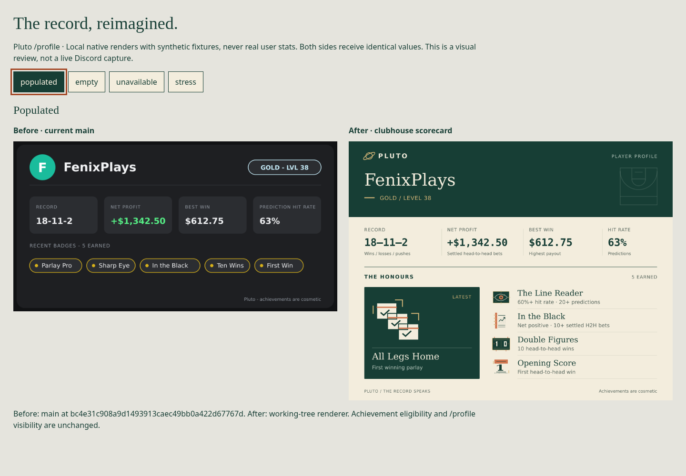
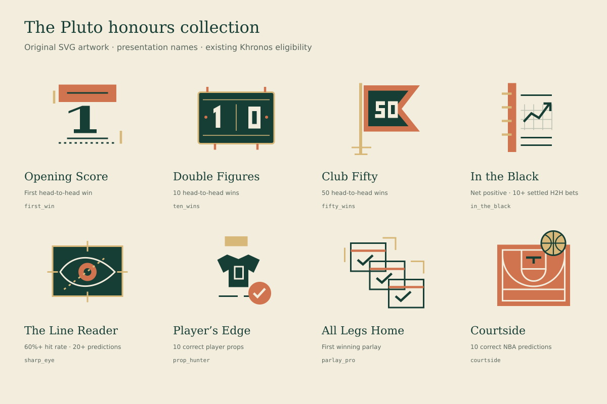

# Pluto profile: clubhouse scorecard

Local, native SVG → PNG evidence using **synthetic fixtures**, not production statistics or live Discord screenshots. The command still replies privately, and its existing invoker-only, single-share behavior and default-off `PROFILE_ENABLED` gate are preserved.

The design uses warm paper, deep green ink, serif identity and fine scorebook rules. One featured honour gives the latest award room; the remaining four form an editorial list. Eight original geometric sports illustrations replace undifferentiated gold dots. No network assets or new dependencies are required, and both font families already ship in the production image's `fonts-dejavu-core` package.





## Source and rejected experiment

- Baseline: `main` at `bc4e31c908a9d1493913caec49bb0a422d67767d`, including merged [#754](https://github.com/fearandesire/Pluto-Betting-Bot/pull/754).
- Closed experiment: [#769](https://github.com/fearandesire/Pluto-Betting-Bot/pull/769). Its final description says it was experimental and not planned for merge. No further design rationale is recorded. Its useful data-flow idea was retaining achievement keys. This implementation does that independently; it does not restore its medallion grid, locked awards or expanded eight-badge limit.
- Khronos remains authoritative for award keys, eligibility, count, ordering and statistics. Presentation names were checked against [the catalogue](https://github.com/fearandesire/khronos/blob/c42b6af6d50ab83bdab19f56704e0c3afb73ddee/apps/api/src/models/achievements/achievement-catalogue.ts), blob `7e3afc58905a9dc107eef9c9e78b22c7a12b88b9`.
- PR base is `main`, per `CONTRIBUTING.md`'s focused-branch workflow, verified remote branch and repository default. `REVIEW.md` establishes the separate release-please gate. This is a draft feature PR, with no merge or release.
- Checked active [#765](https://github.com/fearandesire/Pluto-Betting-Bot/pull/765), [#770](https://github.com/fearandesire/Pluto-Betting-Bot/pull/770) and [#772](https://github.com/fearandesire/Pluto-Betting-Bot/pull/772) before implementation and again before delivery. No overlap with their changed paths: this change does not edit package metadata, lockfile, CI or verification infrastructure.

## Presentation names and unchanged criteria

| Key | Profile name | Existing eligibility | Original illustration |
| --- | --- | --- | --- |
| `first_win` | Opening Score | One head-to-head win | Opening score ticket |
| `ten_wins` | Double Figures | Ten head-to-head wins | Mechanical scoreboard |
| `fifty_wins` | Club Fifty | Fifty head-to-head wins | Club pennant |
| `in_the_black` | In the Black | Positive net profit over at least ten settled head-to-head bets | Ruled bookmaker's ledger |
| `sharp_eye` | The Line Reader | At least 60% hit rate over twenty settled predictions | Scouting-board eye and dotted line |
| `prop_hunter` | Player’s Edge | Ten correct player prop predictions | Player scouting sheet |
| `parlay_pro` | All Legs Home | One winning parlay | Three linked settled tickets |
| `courtside` | Courtside | Ten correct NBA predictions | Half court and basketball |

These are presentation aliases only. Nothing creates awards, changes award rules, pays currency, introduces streaks or infers user performance. Unknown future keys retain their server name and description with neutral scorecard artwork; prototype-like keys cannot resolve inherited object members. Recent awards remain capped at five, in server order, with the full earned count shown separately.

## Before/after frames

Both renderers receive the same fixture statistics, tier, level and earned awards. The old string-badge schema is adapted only by extracting the canonical name. Native sizes are 800 × 420 before and 1000 × 800 after. The added height is deliberate space for readable artwork and an honours list, not a speed improvement.

| State | Outcome | Desktop | Phone | Native PNG |
| --- | --- | --- | --- | --- |
| Populated | One featured honour and four supporting awards | [1440px pair](populated-1440.png) | [390px pair](populated-390.png) | [Before](populated-before.png) / [After](populated-after.png) |
| Empty | A clean scorecard with zero earned awards; no prompt to place more bets | [1440px pair](empty-1440.png) | [390px pair](empty-390.png) | [Before](empty-before.png) / [After](empty-after.png) |
| Unavailable | Missing achievement data is explicitly unavailable, rather than “no badges” | [1440px pair](unavailable-1440.png) | [390px pair](unavailable-390.png) | [Before](unavailable-before.png) / [After](unavailable-after.png) |
| Stress | Long names, loss values, large payouts, future awards and inherited-property names | [1440px pair](stress-1440.png) | [390px pair](stress-390.png) | [Before](stress-before.png) / [After](stress-after.png) |

[Download and open the self-contained comparison carousel](index.html). It includes keyboard-operable state navigation, reduced-motion support and a no-script ordered fallback. The Markdown table above is the static fallback for repository viewers.

The image descriptions include the same stats and achievement criteria as the card. They are attached to both Discord's gallery item and PNG attachment, remain bounded to 1024 characters and survive the existing share flow. Net losses use a minus sign as well as red ink. Long or hostile text is sanitized, escaped and fitted. Standard award names and criteria remain available in image descriptions even when the card abbreviates a long name; unusually long future awards are bounded in both forms.

## Verification and limits

- `pnpm typecheck` passed.
- `pnpm test:run --maxWorkers=2` passed: **728 passed, 20 skipped**. No optional integration checks are claimed as executed.
- `pnpm build` passed: 256 compiled modules, 16 literal dynamic imports and compiled dashboard startup/authentication checks. SWC's native-cache ownership check rejected the restricted sandbox mounts; running the same build and offline suite with normal filesystem permissions succeeded. No source or check was weakened.
- `pnpm exec biome check .` passed for 392 files, with the pre-existing schema-version/deprecation information only. `git diff --check` passed.
- The opt-in native evidence test rendered every state and every achievement, checked all SVG text bounds, checked review-page overflow at 1440/390, and exercised keyboard navigation. All screenshots and the artwork collection were opened and inspected. Reduced motion is enabled during capture to avoid photographing transitions mid-frame.
- [Metrics](metrics.json) record native byte sizes, twelve warm sequential renders per state and text bounds. The fixture manifest records renderer/artwork source SHA-256 values. These are local observations, not Discord latency guarantees. Every card is under 94KB, well below the existing 2MiB sharing limit. SVG construction and rasterization make no network requests.
- At narrow Discord thumbnail sizes the supplementary captions are small; expanding the image or using its text description provides the complete detail. The 390px review is width evidence, not a Discord emulator.
- Real Khronos responses, live Discord display and screen-reader client behavior were not exercised. No Discord messages were sent. Both-services-down handling, bot rejection, invoker binding and single-share behavior retain the existing tests.
- No merge, deployment, release, flag change, betting/financial operation, paid generation or user-PC access occurred. Before enabling profiles, the existing Pluto-Docs `/profile` documentation prerequisite still applies, including these presentation names.

## Reproduce

From this branch with dependencies installed and Chromium available:

```bash
git worktree add --detach /tmp/pluto-profile-baseline bc4e31c908a9d1493913caec49bb0a422d67767d
# Install baseline dependencies or link an already installed compatible node_modules.
PROFILE_CARD_BASE_DIR=/tmp/pluto-profile-baseline \
PROFILE_CARD_SAMPLE_DIR=/tmp/pluto-profile-proof \
PROFILE_CARD_BROWSER=/usr/bin/chromium \
pnpm vitest run src/utils/profile-card/__tests__/sample.test.ts --maxWorkers=2
```

The baseline directory is optional; without it, the page explicitly marks the baseline unavailable. The test uses no external APIs and aborts external browser requests. Fixtures live in `src/utils/profile-card/__tests__/fixtures.ts`; native art is generated by the production `achievement-art.ts` and `profile-card.ts` modules.
